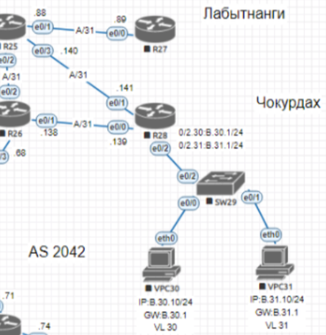

## Маршрутизация на основе политик (PBR) 
### 1. Настроите политику маршрутизации для сетей офиса.
### 2. Распределите трафик между двумя линками с провайдером.
### 3. Настроите отслеживание линка через технологию IP SLA.(только для IPv4)
### 4. Настройте для офиса Лабытнанги маршрут по-умолчанию.
### 5. План работы и изменения зафиксированы в документации .

## ___________________________________________________________________

### Ход работы

**Часть схемы сети, над которой будет производиться настройка.**



### 1. Настроите политику маршрутизации для сетей офиса.
### 2. Распределите трафик между двумя линками с провайдером.
### 3. Настроите отслеживание линка через технологию IP SLA.(только для IPv4)

***Посредством PBR разделим трафик от подсетей VL30 и VL31 по 2 линкам через R28 до Триады. Кроме этого обеспечим дополнительную отказоустойчивость посредством IP SLA:***

***Создадим ACL и опишем в них сети, из которых трафик будет подвергаться обрабокте***

```
ip access-list standard VL30
 permit 192.168.30.0 0.0.0.255
ip access-list standard VL31
 permit 192.168.31.0 0.0.0.255
```

***Создадим маршрутные карты и привяжем трэк для отслежиния состояния линка поочерёдно (обеспечим перекрёстное резервирование):***
```
route-map PBR permit 10
 match ip address VL30
 set ip next-hop verify-availability 10.0.0.138 10 track 1
 set ip next-hop verify-availability 10.0.0.140 20 track 2
!
route-map PBR permit 20
 match ip address VL31
 set ip next-hop verify-availability 10.0.0.140 10 track 2
 set ip next-hop verify-availability 10.0.0.138 20 track 1
!
route-map PBR deny 30 - остальной трафик обрабатываться не будет и пойдёт по стандартным маршрутам.
```
***Создадим объект IP SLA:***
```
ip sla 1
 icmp-echo 10.0.0.138 source-ip 10.0.0.139
 frequency 10
ip sla schedule 1 life forever start-time now
ip sla 2
 icmp-echo 10.0.0.140 source-ip 10.0.0.141
 frequency 10
ip sla schedule 2 life forever start-time now
```
***Привяжем к IP SLA track для обеспечения регирования системы на падение линка:***
```
track 1 ip sla 1 reachability
 delay down 10 up 5
!
track 2 ip sla 2 reachability
 delay down 10 up 5
```
***Привяжем маршрутные карты к интерфейсам:***
```
interface Ethernet0/2.30
 encapsulation dot1Q 30
 ip address 192.168.30.1 255.255.255.0
 ip policy route-map PBR
!
interface Ethernet0/2.31
 encapsulation dot1Q 31
 ip address 192.168.31.1 255.255.255.0
 ip policy route-map PBR
```
***Работа по настройке п. 1-3 выполнена. Настроена политика маршрутизации PBR и обеспечена отказоустойчивость посредством IP SLA***

### 4. Настройте для офиса Лабытнанги маршрут по-умолчанию.

***Для R27 используем стандартную команду:***
```
ip default-gateway 10.0.0.88
```
***Маршрут по умолчанию настроен.***

***Дополненные конфигурации маршрутизаторов:***
- [CHY-R28](./config/R28.txt)
- [CHY-R27](./config/R27.txt)


