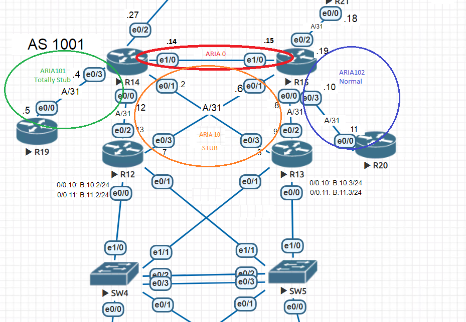
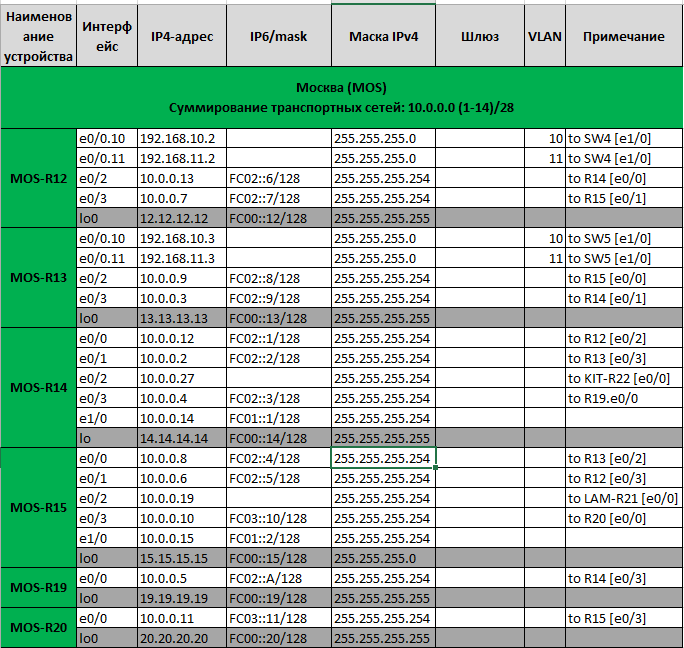

# OSPF с разделением на зоны
### Цели: 
- ##### Настроить OSPF офисе Москва
- ##### Разделить сеть на зоны
- ##### Настроить фильтрацию между зонами

### Описание/Пошаговая инструкция выполнения домашнего задания:
- ##### 1. Маршрутизаторы R14-R15 находятся в зоне 0 - backbone.
- ##### 2. Маршрутизаторы R12-R13 находятся в зоне 10. Дополнительно к маршрутам должны получать маршрут по умолчанию.
- ##### 3. Маршрутизатор R19 находится в зоне 101 и получает только маршрут по умолчанию.
- ##### 4. Маршрутизатор R20 находится в зоне 102 и получает все маршруты, кроме маршрутов до сетей зоны 101.
- ##### 5. Настройка для IPv6 повторяет логику IPv4.
- ##### 6. План работы и изменения зафиксированы в документации 

## ___________________________________________________________________

### Ход работы

**Часть схемы сети, над которой будет производиться настройка.**




##### 1. Маршрутизаторы R14-R15 находятся в зоне 0 - backbone.
**Чтобы зона 0 была без разрывов, добавим между R14 и  R15 линк**
**Далее настроим интерфейсы R14-R15 так, чтоб они были в одной зоне:**

```
R14:
interface Ethernet1/0
 description "to R15 (area 0)"
 ip address 10.0.0.14 255.255.255.254
 ip ospf network point-to-point
 ip ospf 1 area 0
 ipv6 address FC01::1/128
 ospfv3 network point-to-point
 ospfv3 2 ipv6 area 0
!
router ospfv3 2
 !
 address-family ipv6 unicast
  router-id 14.14.14.14
  area 10 stub
  area 101 stub no-summary - К пункту 3 - для R19 маршрута по-умолчанию
 exit-address-family
!
router ospf 1
 router-id 14.14.14.14
 area 10 stub
 area 101 stub no-summary

R15
interface Ethernet1/0
 description "to R14 [1/0]"
 ip address 10.0.0.15 255.255.255.254
 ip ospf network point-to-point
 ip ospf 1 area 0
 ipv6 address FC01::2/128
 ospfv3 network point-to-point
 ospfv3 2 ipv6 area 0
!
router ospfv3 2
 !
 address-family ipv6 unicast
  router-id 15.15.15.15
  area 10 stub
  area 102 filter-list prefix 6block_area101 in
 exit-address-family
!
router ospf 1
 router-id 15.15.15.15
 area 10 stub
 area 102 filter-list prefix block_area101 in
!
ip prefix-list block_area101 seq 5 deny 10.0.0.4/31 - К пункту 4 - Маршрутизатор R20 находится в зоне 102 и получает все маршруты, кроме маршрутов до сетей зоны 101.
ip prefix-list block_area101 seq 10 permit 0.0.0.0/0 le 32
!
!
ipv6 prefix-list 6block_area101 seq 5 deny FC02::3/128 - Маршрутизатор R20 находится в зоне 102 и получает все маршруты, кроме маршрутов до сетей зоны 101.
ipv6 prefix-list 6block_area101 seq 10 permit ::/0 le 128
```
##### 2. Маршрутизаторы R12-R13 находятся в зоне 10. Дополнительно к маршрутам должны получать маршрут по умолчанию.

```
R12:
interface Ethernet0/2
 description "to R14 [e0/0]"
 ip address 10.0.0.13 255.255.255.254
 ip ospf network point-to-point
 ip ospf 1 area 10
 ipv6 address FC02::6/128
 ospfv3 network point-to-point
 ospfv3 2 ipv6 area 10
!
interface Ethernet0/3
 description "to R15 [e0/1]"
 ip address 10.0.0.7 255.255.255.254
 ip ospf network point-to-point
 ip ospf 1 area 10
 ipv6 address FC02::7/128
 ospfv3 network point-to-point
 ospfv3 2 ipv6 area 10
!
router ospfv3 2
 !
 address-family ipv6 unicast
  router-id 12.12.12.12
  area 10 stub
 exit-address-family
!
router ospf 1
 router-id 12.12.12.12
 area 10 stub
!

R13:
interface Ethernet0/2
 description "to R15 [e 0/0]"
 ip address 10.0.0.9 255.255.255.254
 ip ospf network point-to-point
 ip ospf 1 area 10
 ipv6 address FC02::8/128
 ospfv3 network point-to-point
 ospfv3 2 ipv6 area 10
!
interface Ethernet0/3
 description "to R14 [e 0/1]"
 ip address 10.0.0.3 255.255.255.254
 ip ospf network point-to-point
 ip ospf 1 area 10
 ipv6 address FC02::9/128
 ospfv3 network point-to-point
 ospfv3 2 ipv6 area 10
!
router ospfv3 2
 !
 address-family ipv6 unicast
  router-id 13.13.13.13
  area 10 stub
 exit-address-family
!
router ospf 1
 router-id 13.13.13.13
 area 10 stub
```
##### 3. Маршрутизатор R19 находится в зоне 101
```
R19:
interface Ethernet0/0
 description "to R14 [e0/3]"
 ip address 10.0.0.5 255.255.255.254
 ip ospf network point-to-point
 ip ospf 1 area 101
 ipv6 address FC02::A/128
 ospfv3 network point-to-point
 ospfv3 2 ipv6 area 101
!
router ospfv3 2
 !
 address-family ipv6 unicast
  router-id 19.19.19.19
  area 101 stub
 exit-address-family
!
router ospf 1
 router-id 19.19.19.19
 area 101 stub
```

##### 4. Маршрутизатор R20 находится в зоне 102
```
R20:
interface Ethernet0/0
 description "to R15 [e 0/3]"
 ip address 10.0.0.11 255.255.255.254
 ip ospf network point-to-point
 ip ospf 1 area 102
 ipv6 address FC03::11/128
 ospfv3 network point-to-point
 ospfv3 2 ipv6 area 102
!
router ospfv3 2
 !
 address-family ipv6 unicast
  router-id 20.20.20.20
 exit-address-family
!
router ospf 1
 router-id 20.20.20.20
```
***Выше даны все критичные настройки для реализации маршрутизации между зонами посредством OSPF в соответствии с заданием***
***Дополненные конфигурации устройств и общая схема:***
- [R12](./config/R12.txt)
- [R13](./config/R13.txt)
- [R14](./config/R14.txt)
- [R15](./config/R15.txt)
- [R19](./config/R19.txt)
- [R20](./config/R20.txt)
- [main sheme](./config/OSPFv4v6_unl.zip)


  #### Результаты работы:
  
  
  
  
  
  
##### 6. План работы и изменения зафиксированы в документации:




