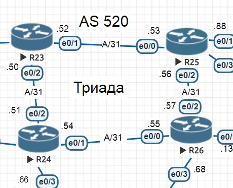

# IS-IS

### Цели:
##### Настроить IS-IS офисе Триада

### Описание/Пошаговая инструкция выполнения домашнего задания:
 ##### 1. R23 и R25 находятся в зоне 2222;
 ##### 2. R24 находится в зоне 24;
 ##### 3. R26 находится в зоне 26;
 ##### 4. Настройка осуществляется одновременно для IPv4 и IPv6;


## ___________________________________________________________________

### Ход работы

**Часть схемы сети, над которой будет производиться настройка.**




##### 1. R23 и R25 находятся в зоне 2222
***Настроим EIGRP на R23 и R25 в соответствии с заданием:***

```
R23:
hostname R23
!
ipv6 unicast-routing
ipv6 cef
!
interface Loopback0
 ip address 23.23.23.23 255.255.255.255
 ip router isis 1 - номер процесса v4
 ipv6 address FC00::23/128
 ipv6 router isis 1 - номер процесса v6
!
interface Ethernet0/1
 description "to R25 [e0/0]"
 ip address 10.0.0.52 255.255.255.254
 ip router isis 1
 ipv6 address FC01:0:0:52::/127
 ipv6 router isis 1
 isis circuit-type level-1 - принудительно зададим уровень соседства
 isis network point-to-point - вид линка (точка-точка)
!
interface Ethernet0/2
 description "to R24 [e0/2]"
 ip address 10.0.0.50 255.255.255.254
 ip router isis 1
 ipv6 address FC01:0:0:50::/127
 ipv6 router isis 1
 isis circuit-type level-2-only
 isis network point-to-point
!
router isis 1
 net 49.2222.0000.0023.00 - зададим  Area ID, System ID, NSEL
 metric-style wide
 log-adjacency-changes
!
end

R25 - всё аналогично:
R25#sh run
!
hostname R25
!
ipv6 unicast-routing
ipv6 cef
!
interface Loopback0
 ip address 25.25.25.25 255.255.255.255
 ip router isis 1
 ipv6 address FC00::25/128
 ipv6 router isis 1
!
interface Ethernet0/0
 description "to R23 [e0/1]"
 ip address 10.0.0.53 255.255.255.254
 ip router isis 1
 ipv6 address FC01:0:0:52::1/127
 ipv6 router isis 1
 isis circuit-type level-1
 isis network point-to-point
!
interface Ethernet0/2
 description "to R26 [e0/2]"
 ip address 10.0.0.56 255.255.255.254
 ip router isis 1
 ipv6 address FC01:0:0:56::/127
 ipv6 router isis 1
 isis circuit-type level-2-only
 isis network point-to-point
!
router isis 1
 net 49.2222.0000.0025.00
 metric-style wide
 log-adjacency-changes
!
end
```


