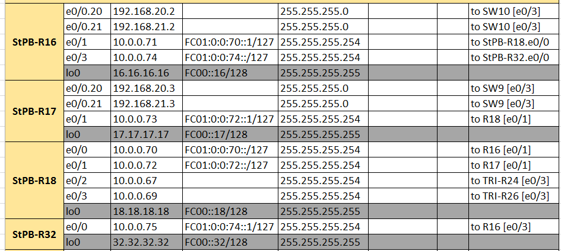
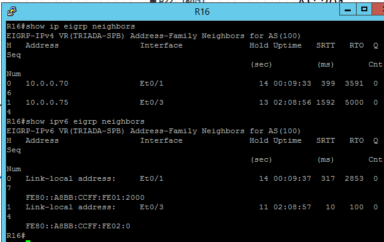
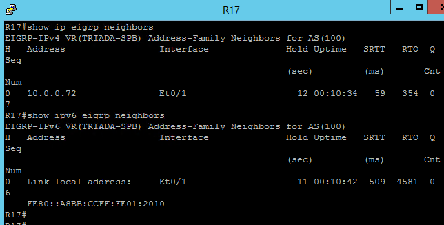
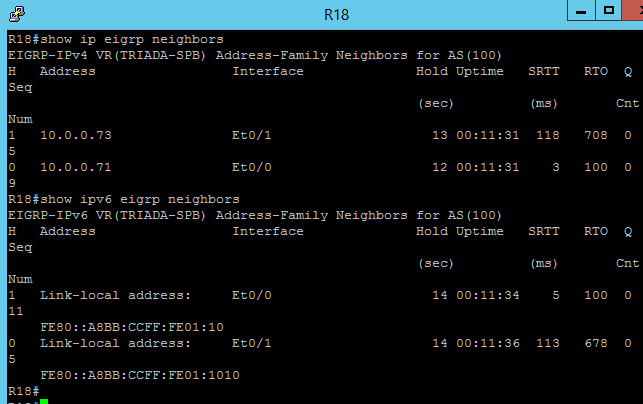
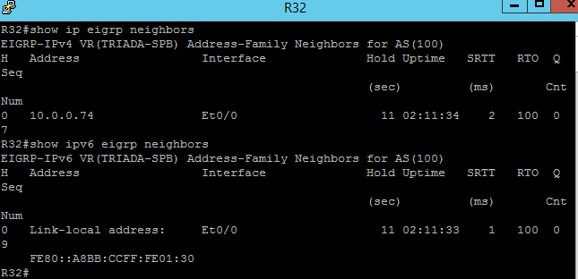
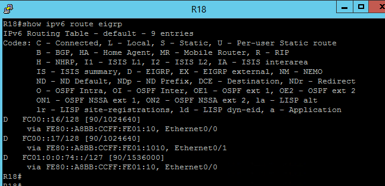
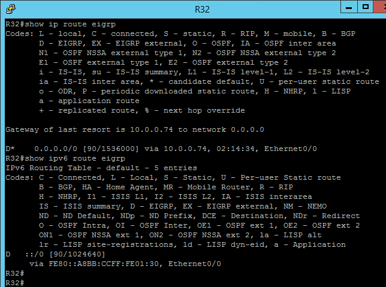

# EIGRP

### Цели:
 ##### Настроить EIGRP в С.-Петербург
 ##### Использовать named EIGRP

### Описание/Пошаговая инструкция выполнения домашнего задания:
##### 1. В офисе С.-Петербург настроить EIGRP.
##### 2. R32 получает только маршрут по умолчанию.
##### 3. R16-17 анонсируют только суммарные префиксы.
##### 4. Использовать EIGRP named-mode для настройки сети.
##### 5. Настройка осуществляется одновременно для IPv4 и IPv6.

## ___________________________________________________________________

### Ход работы

**Часть схемы сети, над которой будет производиться настройка.**


##### 1. В офисе С.-Петербург настроить EIGRP.

***Ниже в пунктах 2-5 будет представлен процесс настройки EIGRP в офисе С.-Петербург***

##### 2. R32 получает только маршрут по умолчанию.

***Настроим R32 в соответствии с заданием:***

```
R32:
R32#sh run
!
hostname R32
!
ip cef
ipv6 unicast-routing
ipv6 cef
!
interface Loopback0
 ip address 32.32.32.32 255.255.255.255
 ipv6 address FC00::32/128
!
interface Ethernet0/0
 description "to R16 [e0/3]"
 ip address 10.0.0.75 255.255.255.254
 ipv6 address FC01:0:0:74::1/127
 ipv6 eigrp 100
!
router eigrp TRIADA-SPB - запустим процесс named mode
 !
 address-family ipv4 unicast autonomous-system 100 - откроем бок настроек ipv4 для АС100
  !
  topology base  - войдём в настройки текущей топологии
   distribute-list prefix ONLY-DEF in - отфильтруем приходящие маршруты
  exit-af-topology
  network 10.0.0.74 0.0.0.1 - включим EIGRP на интерфейсах из диапазона
  eigrp router-id 32.32.32.32 - зададим ID роутера
  eigrp stub receive-only
 exit-address-family
 !
 address-family ipv6 unicast autonomous-system 100
  !
  topology base
   distribute-list prefix-list ONLY-DEFv6 in - подключим фильтрацию
  exit-af-topology
  eigrp router-id 32.32.32.32
  eigrp stub receive-only - R32 тупиковый, только принимает маршруты
 exit-address-family
!
ip prefix-list ONLY_DEF seq 5 permit 0.0.0.0/0 - только точный дефолт
!
!
ipv6 prefix-list ONLY-DEFv6 seq 5 permit ::/0 - только ::/0
!
end
```

##### 3. R16-17 анонсируют только суммарные префиксы.

***Настроим R16-17 в соответствии с заданием. Все маршрутизаторы содержат аналогичные блоки настроек:***

```
R16:
R16#sh run
!
hostname R16
!
ip cef
ipv6 unicast-routing
ipv6 cef
!
interface Loopback0
 ip address 16.16.16.16 255.255.255.255
 ipv6 address FC00::16/128
!
interface Ethernet0/1
 description "to R18 [e0/0]"
 ip address 10.0.0.71 255.255.255.254
 ipv6 address FC01:0:0:70::1/127
 ipv6 eigrp 100
!
interface Ethernet0/3
 description "to R32 [e0/0]"
 ip address 10.0.0.74 255.255.255.254
 ipv6 address FC01:0:0:74::/127
 ipv6 eigrp 100
!
router eigrp TRIADA-SPB
 !
 address-family ipv4 unicast autonomous-system 100
  !
  af-interface Ethernet0/1
   summary-address 10.0.0.0 255.255.0.0 - суммарный маршрут
  exit-af-interface
  !
  af-interface Ethernet0/3
   summary-address 0.0.0.0 0.0.0.0  -  суммарный маршрут по умолчанию
  exit-af-interface
  !
  topology base
  exit-af-topology
  network 10.0.0.70 0.0.0.1
  network 10.0.0.74 0.0.0.1
  eigrp router-id 16.16.16.16
  eigrp stub connected summary
 exit-address-family
 !
 address-family ipv6 unicast autonomous-system 100
  !
  af-interface Ethernet0/1
   summary-address FC00:16::/32
  exit-af-interface
  !
  af-interface Ethernet0/3
   summary-address ::/0
  exit-af-interface
  !
  topology base
  exit-af-topology
  eigrp router-id 16.16.16.16
  eigrp stub connected summary
 exit-address-family
!
no ip http server
no ip http secure-server
ip route 0.0.0.0 0.0.0.0 10.0.0.70
!
ipv6 route ::/0 FC01:0:0:70::
!
end

R17:

R17#sh run
!
hostname R17
!
ip cef
ipv6 unicast-routing
ipv6 cef
!
interface Loopback0
 ip address 17.17.17.17 255.255.255.255
 ipv6 address FC00::17/128
!
interface Ethernet0/1
 description "to R18 [e0/1]"
 ip address 10.0.0.73 255.255.255.254
 ipv6 address FC01:0:0:72::1/127
!
router eigrp TRIADA-SPB
 !
 address-family ipv4 unicast autonomous-system 100
  !
  af-interface Ethernet0/1
   summary-address 10.0.0.0 255.255.0.0
  exit-af-interface
  !
  topology base
  exit-af-topology
  network 10.0.0.72 0.0.0.1
  eigrp router-id 17.17.17.17
  eigrp stub connected summary
 exit-address-family
 !
 address-family ipv6 unicast autonomous-system 100
  !
  af-interface Ethernet0/1
   summary-address FC00:17::/32
  exit-af-interface
  !
  topology base
  exit-af-topology
  eigrp router-id 17.17.17.17
  eigrp stub connected summary
 exit-address-family
!
end
```

***Настроим R18:***
```
R18#sh run
!
hostname R18
!
ip cef
ipv6 unicast-routing
ipv6 cef
!
interface Loopback0
 ip address 18.18.18.18 255.255.255.255
 ipv6 address FC00::18/128
 ipv6 eigrp 100
!
interface Ethernet0/0
 description "to R16 [e0/1]"
 ip address 10.0.0.70 255.255.255.254
 ipv6 address FC01:0:0:70::/127
 ipv6 eigrp 100
!
interface Ethernet0/1
 description "to R17 [e0/1]"
 ip address 10.0.0.72 255.255.255.254
 ipv6 address FC01:0:0:72::/127
 ipv6 eigrp 100
!
interface Ethernet0/2
 description "to R24 [e0/3]"
 ip address 10.0.0.67 255.255.255.254
!
interface Ethernet0/3
 description "to R26 [e0/3]"
 ip address 10.0.0.69 255.255.255.254
!
router eigrp TRIADA-SPB
 !
 address-family ipv4 unicast autonomous-system 100
  !
  topology base
  exit-af-topology
  network 10.0.0.70 0.0.0.1
  network 10.0.0.72 0.0.0.1
  network 18.18.18.18 0.0.0.0
  eigrp router-id 18.18.18.18
 exit-address-family
 !
 address-family ipv6 unicast autonomous-system 100
  !
  topology base
  exit-af-topology
  eigrp router-id 18.18.18.18
 exit-address-family
!
end
```

##### 4. Использовать EIGRP named-mode для настройки сети - ***данный пункт выполнен при настройке маршрутизаторов.***
##### 5. Настройка осуществляется одновременно для IPv4 и IPv6 - ***данный пункт выполнен при настройке маршрутизаторов***.

***5. План работы и изменения зафиксированы в документации:***



***Дополненные конфигурации устройств:***
- [R16](./config/R16.txt)
- [R17](./config/R17.txt)
- [R18](./config/R18.txt)
- [R32](./config/R32.txt)

    
#### Результаты работы:

 
 
 
 
 
 
 
  


