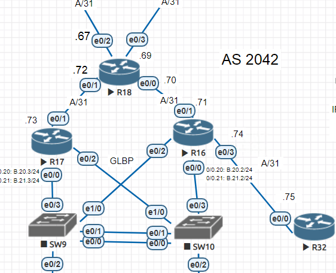

# EIGRP

### Цели:
 ##### Настроить EIGRP в С.-Петербург
 ##### Использовать named EIGRP

### Описание/Пошаговая инструкция выполнения домашнего задания:
##### 1. В офисе С.-Петербург настроить EIGRP.
##### 2. R32 получает только маршрут по умолчанию.
##### 3. R16-17 анонсируют только суммарные префиксы.
##### 4. Использовать EIGRP named-mode для настройки сети.
##### 5. Настройка осуществляется одновременно для IPv4 и IPv6.

## ___________________________________________________________________

### Ход работы

**Часть схемы сети, над которой будет производиться настройка.**

##### 1. В офисе С.-Петербург настроить EIGRP.

***Ниже в пунктах 2-5 будет представлен процесс настройки EIGRP в офисе С.-Петербург***

##### 2. R32 получает только маршрут по умолчанию.
##### 3. R16-17 анонсируют только суммарные префиксы.
##### 4. Использовать EIGRP named-mode для настройки сети.
##### 5. Настройка осуществляется одновременно для IPv4 и IPv6.

