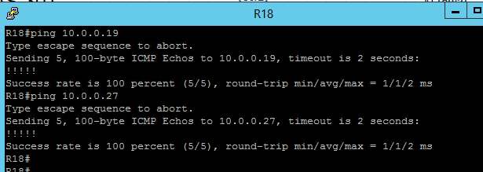

# BGP

### Цели:
- ##### Настроить BGP между автономными системами
- ##### Организовать доступность между офисами Москва и С.-Петербург

### Описание/Пошаговая инструкция выполнения домашнего задания:
##### 1. Настроите eBGP между офисом Москва и двумя провайдерами - Киторн и Ламас.
##### 2. Настроите eBGP между провайдерами Киторн и Ламас.
##### 3. Настроите eBGP между Ламас и Триада.
##### 4. Настроите eBGP между офисом С.-Петербург и провайдером Триада.
##### 5. Организуете IP доступность между пограничным роутерами офисами Москва и С.-Петербург.

## ___________________________________________________________________

### Ход работы

**Часть схемы сети, над которой будет производиться настройка.**


##### 1. Настроите eBGP между офисом Москва и двумя провайдерами - Киторн и Ламас.
***Выполним настройку в соответствии с пунктом 1:***

```
R14:
(config)#router bgp 1001 - зададим номер АС
(config-router)#neighbor 10.0.0.26 remote-as 101 - зададим ip соседа и его номер АС

R22:
(config)#router bgp 101
(config-router)#neighbor 10.0.0.27 remote-as 1001
(config-router)#address-family ipv4
(config-router-af)#redistribute connected - передадим известные маршруты соседу

R15:
(config)#router bgp 1001
(config-router)#neighbor 10.0.0.18 remote-as 301

R21:
(config)#router bgp 301
(config-router)#neighbor 10.0.0.19 remote-as 1001
```

***Далее все настройки аналогичны.***

##### 2. Настроите eBGP между провайдерами Киторн и Ламас.
***Выполним настройку в соответствии с пунктом 2:***

```
R21:
(config)#router bgp 301
(config-router)#neighbor 10.0.0.21 remote-as 101
(config-router)#redistribute connected

R22:
(config)#router bgp 101
(config-router)#neighbor 10.0.0.20 remote-as 301
```

##### 3. Настроите eBGP между Ламас и Триада.
***Выполним настройку в соответствии с пунктом 3:***

```
R21:
(config)#router bgp 301
(config-router)#neighbor 10.0.0.40 remote-as 520

R24:
(config)#router bgp 520
(config-router)#neighbor 10.0.0.41 remote-as 301
(config-router)#redistribute connected
```

##### 4. Настроите eBGP между офисом С.-Петербург и провайдером Триада.
***Выполним настройку в соответствии с пунктом 4:***

```
R24:
(config)#router bgp 520
(config-router)#neighbor 10.0.0.67 remote-as 2042
R26:
(config)#router bgp 520
(config-router)#neighbor 10.0.0.69 remote-as 2042
R18:
(config)#router bgp 2042
(config-router)#neighbor 10.0.0.68 remote-as 520
(config)#router bgp 2042
(config-router)#neighbor 10.0.0.66 remote-as 520
```

##### 5. Организуете IP доступность между пограничным роутерами офисами Москва и С.-Петербург.

***Доступность организована посредством настроек, выполненных выше в п.1-4.***

***Пропингуем маршрутизаторы R14 и R15 с маршрутизатора R18. Результат сетевой связности представлен ниже:***




