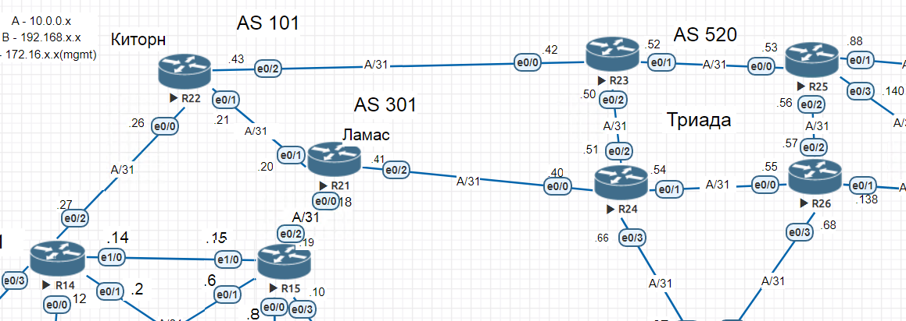

# BGP

### Цели:
- ##### Настроить BGP между автономными системами
- ##### Организовать доступность между офисами Москва и С.-Петербург

### Описание/Пошаговая инструкция выполнения домашнего задания:
##### 1. Настроите eBGP между офисом Москва и двумя провайдерами - Киторн и Ламас.
##### 2. Настроите eBGP между провайдерами Киторн и Ламас.
##### 3. Настроите eBGP между Ламас и Триада.
##### 4. Настроите eBGP между офисом С.-Петербург и провайдером Триада.
##### 5. Организуете IP доступность между пограничным роутерами офисами Москва и С.-Петербург.

## ___________________________________________________________________

### Ход работы

**Часть схемы сети, над которой будет производиться настройка.**



##### 1. Настроите eBGP между офисом Москва и двумя провайдерами - Киторн и Ламас.
***Выполним настройку в соответствии с пунктом 1:***

```
R14:
(config)#router bgp 1001
(config-router)#neighbor 10.17.1.1 remote-as 101
R22:
(config)#router bgp 101
(config-router)#neighbor 10.17.1.4 remote-as 1001
(config-router)#address-family ipv4
(config-router-af)#redistribute connected
R15:
(config)#router bgp 1001
(config-router)#neighbor 10.18.1.1 remote-as 301
R21:
(config)#router bgp 301
(config-router)#neighbor 10.18.1.2 remote-as 1001
```


